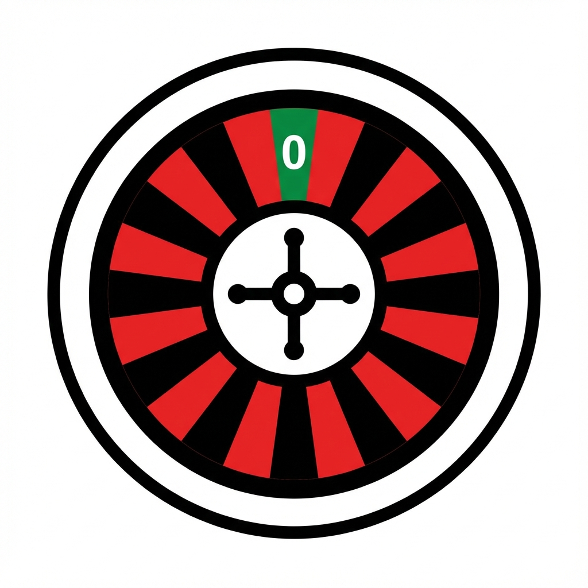
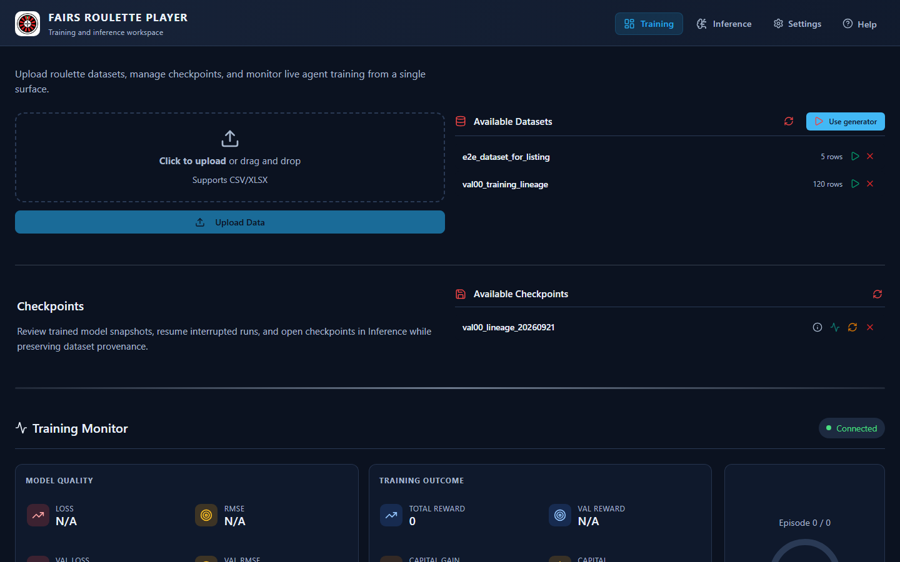
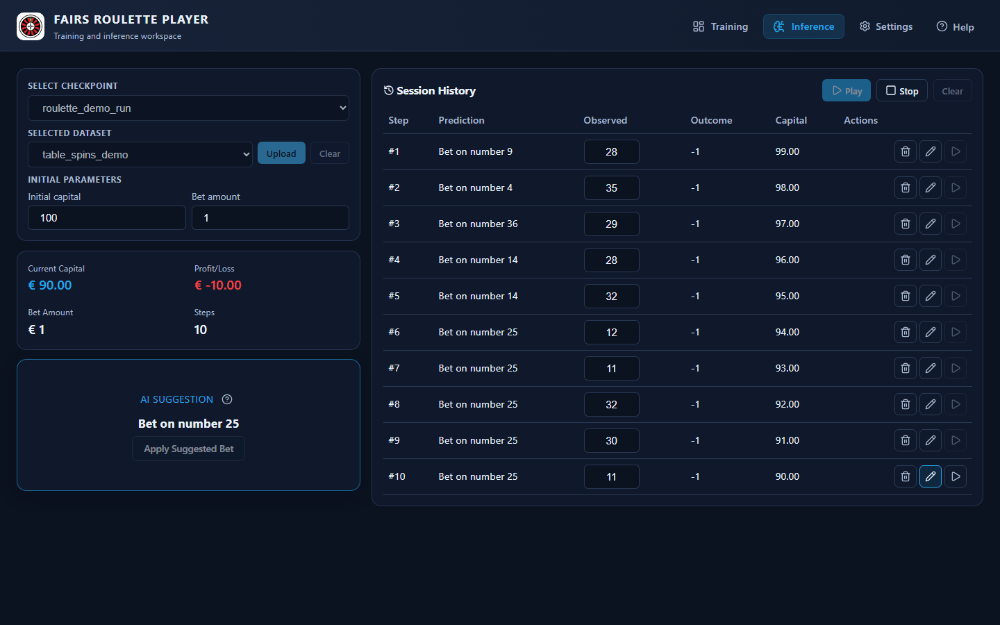

<p align="center"></p>

<h1 align="center">FAIRS Roulette Player</h1>

<p align="center">A local research workspace for roulette training experiments and step-by-step inference sessions.</p>

<p align="center">
  <a href="https://github.com/CTCycle/FAIRS-Roulette-Player/stargazers"></a>
  <a href="https://github.com/CTCycle/FAIRS-Roulette-Player/commits"></a>
  <a href="https://github.com/CTCycle/FAIRS-Roulette-Player/releases"></a>
  <a href="LICENSE"></a>
</p>

<p align="center">
  <a href="https://www.python.org/"></a>
  <a href="https://react.dev/"></a>
  <a href="https://www.microsoft.com/windows"></a>
</p>

> FAIRS is an experimental research tool. Its suggestions are not guaranteed predictions or gambling advice. Roulette outcomes remain uncertain, and results from a simulation may not generalize to new data or future play.

## Overview

FAIRS is a local browser-based workspace for preparing roulette data, training an agent, saving checkpoints, and reviewing model suggestions against observed outcomes. It models a single-zero wheel with outcomes from 0 through 36.

## Key Features

- Import CSV or XLSX datasets and preview them, or generate synthetic data for repeatable experiments.
- Configure and monitor training runs, review their metrics, and save or resume checkpoints.
- Pair a checkpoint with a dataset and step through inference one round at a time.
- Record observed outcomes and review predictions, bets, capital, results, and session history.
- Use SQLite by default or configure an external PostgreSQL database.

## Screenshots

<p align="center">
  <kbd></kbd>
  <kbd></kbd>
</p>
<p align="center"><em>Training workspace and inference session. Example interface states; results and charts depend on the selected data, checkpoint, and run settings.</em></p>

## Technology Stack

| Layer | Technology |
|---|---|
| Backend | Python 3.14.7, FastAPI 0.128.0 |
| Web client | React 19, TypeScript 5.9, Vite 7 |
| Build tooling | Node.js 22.13.0 |
| Database | SQLite (default), PostgreSQL |
| Minimum browser width | 1100 pixels |
| Launcher | Windows PowerShell with portable Python, uv, and Node.js |

## Installation and Usage

Windows is the supported launch environment. Extract the repository into a writable folder, open PowerShell at its root, and run:

```powershell
.\start_on_windows.ps1
```

Choose **Launch application**. On first use, the launcher prepares the local runtimes, dependencies, and database. Internet access is required to download missing runtimes and packages. The interface is designed for desktop browser windows at least 1100 pixels wide; mobile layouts are not supported.

Manual (from source):

```powershell
cd app/server
uv sync
cd ../client
npm install
```

Then start the backend and client following [Runtime startup](assets/docs/runtime/startup.md).

## Configuration

| Variable | Default | Purpose |
|---|---|---|
| `FASTAPI_HOST` | `127.0.0.1` | Backend host |
| `FASTAPI_PORT` | `8890` | Backend port |
| `UI_HOST` | `127.0.0.1` | Frontend host |
| `UI_PORT` | `8051` | Frontend port |
| `API_BASE_URL` | empty | Vite proxy target |
| `CORS_ORIGINS` | empty | Comma-separated allowed browser origins |
| `ENABLE_API_DOCS` | `true` | Enable API docs |
| `RELOAD` | `false` | Enable backend reload |
| `FAIRS_DATA_DIR` | empty | Data root for database, logs, and checkpoints |
| `MPLBACKEND` | `Agg` | Matplotlib backend |
| `KERAS_BACKEND` | `torch` | Keras backend |

The launcher creates `settings/.env` from `settings/.env.example` when needed. Set the API proxy target, listener hosts and ports, or optional CORS origins there before launch; these deployment values are separate from the user preferences saved by the Settings page. FAIRS stores local datasets, checkpoints, and logs under `data` by default; set `FAIRS_DATA_DIR` to choose another persistent data root. Training and inference preferences are available in the application.

## Documentation

- [Quick Start](assets/docs/operations/quick_start.md)
- [Training and inference workflows](assets/docs/operations/workflows.md)
- [Runtime startup](assets/docs/runtime/startup.md)
- [Runtime configuration](assets/docs/runtime/configuration.md)
- [Troubleshooting](assets/docs/operations/troubleshooting.md)

## Limitations

- Experimental research tool; suggestions are not guaranteed predictions or gambling advice.
- Roulette outcomes remain uncertain, and simulation results may not generalize to new data or future play.
- Single-zero wheel with outcomes from 0 through 36 only.
- Desktop browser windows at least 1100 pixels wide; no mobile layout.

## Contributing

Contributions are welcome. Open an issue or pull request with a clear description of the change and its motivation.

## License

Licensed under the MIT License. See [LICENSE](LICENSE).
