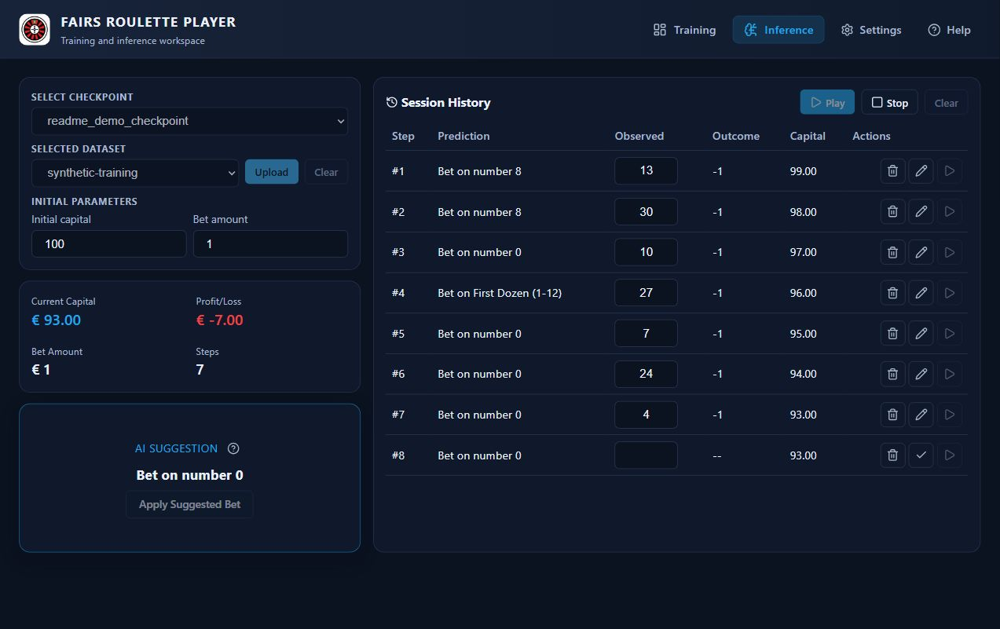
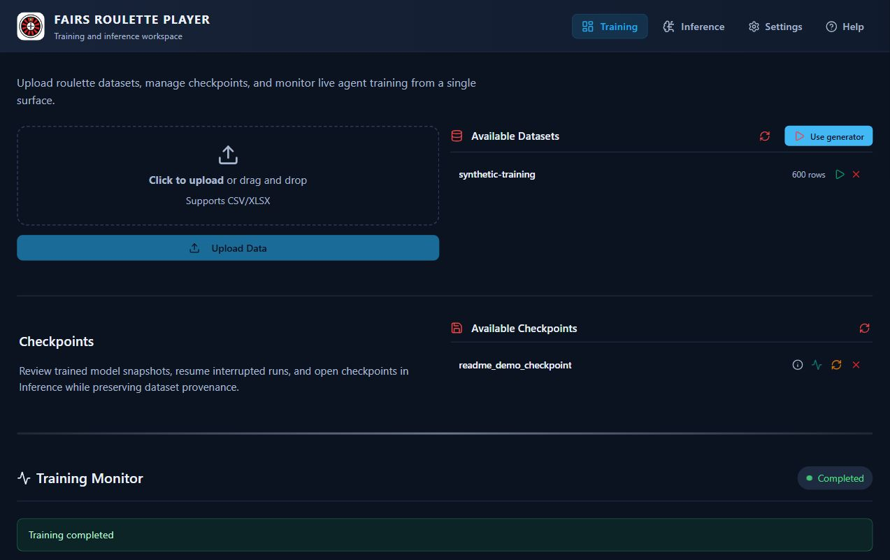

<p align="center"></p>

<h1 align="center">FAIRS Roulette Player</h1>

<p align="center">A local workspace for training roulette agents and reviewing their suggestions one spin at a time.</p>

<p align="center">
  <a href="https://github.com/CTCycle/FAIRS-Roulette-Player/stargazers"></a>
  <a href="https://github.com/CTCycle/FAIRS-Roulette-Player/commits"></a>
</p>

<p align="center">
  <a href="https://github.com/CTCycle/FAIRS-Roulette-Player/releases"></a>
  <a href="https://github.com/CTCycle/FAIRS-Roulette-Player/actions/workflows/ci.yml?query=branch%3Adevelop"></a>
  <a href="LICENSE"></a>
</p>

<p align="center">
  <a href="https://www.python.org/"></a>
  <a href="https://react.dev/"></a>
  <a href="https://www.microsoft.com/windows"></a>
</p>

<p align="center">
  <a href="#training">Training</a> ·
  <a href="#inference">Inference</a> ·
  <a href="#start-fairs">Start FAIRS</a> ·
  <a href="#configuration">Configuration</a> ·
  <a href="assets/docs/project_index.md">Documentation</a>
</p>

<p align="center"></p>

FAIRS imports spin histories from CSV or XLSX, or generates synthetic outcomes for repeatable experiments. Train an agent, keep or resume its checkpoint, then use it with a dataset in an inference session. Each round records the suggestion, observed outcome, bet, and session result.

> **Research use only.** FAIRS suggestions are experimental; roulette outcomes remain uncertain. This is not gambling advice.

## Inference

Choose a trained checkpoint and dataset, set an initial capital and bet, then start a session. Review the agent's suggestion, enter or edit the observed outcome, and step through the session history. The page keeps the current capital and results alongside each round.

## Training

Upload a CSV or XLSX spin history, or use the synthetic data generator. Review the dataset and configure an agent in the training wizard. The Training page shows run status, progress, metrics, and charts; completed checkpoints can be resumed or opened in Inference.

<p align="center"></p>

Both screenshots use synthetic outcomes. They show the workflow, not predictive performance.

## Start FAIRS

Windows is the supported launcher platform. From the repository root in PowerShell, run:

```powershell
.\start_on_windows.ps1 -Launch
```

The launcher prepares the local runtimes and dependencies, builds the web client when needed, and opens the application. It needs internet access to download missing runtimes or packages. The default address is `http://127.0.0.1:8890/`. Keep the launcher console open while using FAIRS; press **Ctrl+C** there to stop it.

## Configuration

The launcher creates `settings/.env` from [`settings/.env.example`](settings/.env.example) when needed. FAIRS stores its database, datasets, checkpoints, and logs under `data` by default; set `FAIRS_DATA_DIR` to use another data directory. SQLite is the default database, and PostgreSQL can be configured from the Settings page.

See [runtime configuration](assets/docs/runtime/configuration.md) for environment variables and database setup, and [troubleshooting](assets/docs/operations/troubleshooting.md) for startup issues.

## Development

FAIRS is distributed as source and runs as a local web app. Its backend uses Python and FastAPI; the React and TypeScript client is built with Vite. FastAPI serves the built client and API from the same origin. The layout requires a browser window at least 1100 pixels wide; mobile layouts are not supported.

See [runtime startup](assets/docs/runtime/startup.md) for manual development commands and [the project documentation index](assets/docs/project_index.md) for architecture, testing, and operations guides.

## Contributing

Issues and pull requests are welcome. Please describe the problem and keep changes focused; the [testing and quality guide](assets/docs/coding/testing_and_quality.md) covers project conventions.

## License

[MIT](LICENSE)
